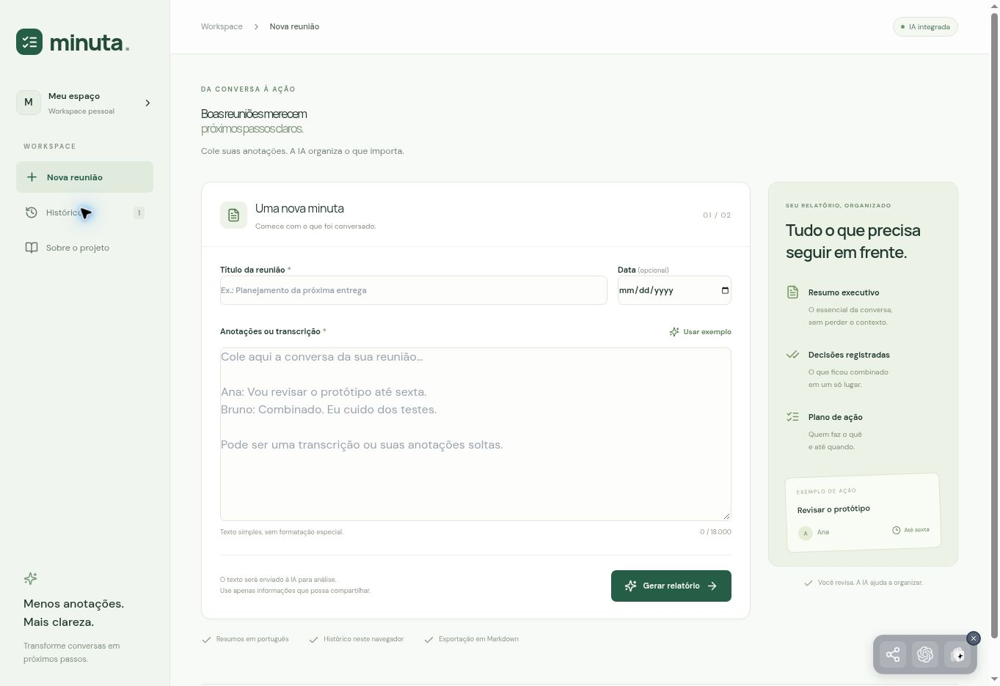
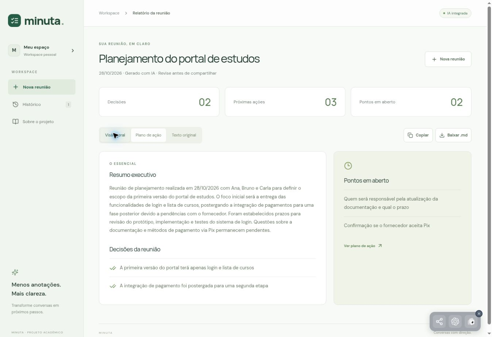
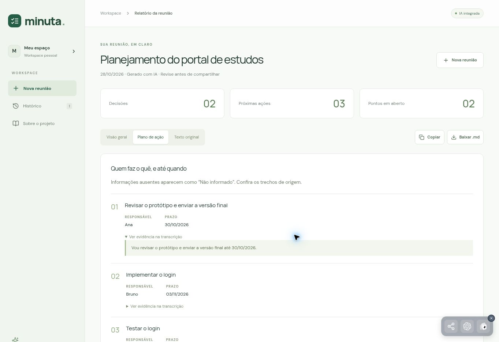
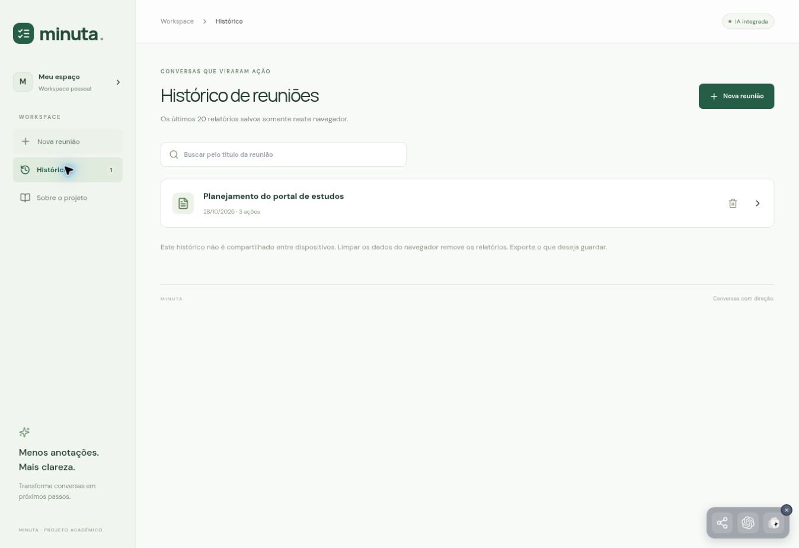

# Telas e demonstração

## 1. Nova reunião

A tela recebe título, data opcional e transcrição. O botão **Usar exemplo** preenche uma reunião fictícia sobre um portal de estudos. **Gerar relatório** envia o texto à IA. Campos inválidos mostram uma mensagem; durante o processamento, o formulário fica desabilitado para evitar cliques duplicados.

## 2. Visão geral

Mostra resumo executivo, decisões e pontos em aberto. Os contadores são calculados a partir da resposta. Na execução registrada, foram identificadas duas decisões, três ações e duas pendências. Não são métricas fictícias fixadas na interface.

## 3. Plano de ação e texto original

Cada ação apresenta tarefa, responsável, prazo e um trecho expansível de evidência. A aba **Texto original** permite comparar o resultado com a entrada. O backend verifica se a evidência retornada aparece literalmente na transcrição; se não aparecer, sinaliza a necessidade de revisão.

| Ação identificada no exemplo | Responsável | Prazo |
|---|---|---|
| Revisar o protótipo e enviar a versão final | Ana | 30/10/2026 |
| Implementar o login | Bruno | 03/11/2026 |
| Testar o login | Carla | 05/11/2026 |

A documentação ficou como pendência porque a reunião não definiu quem faria a atualização nem quando. A integração de pagamentos foi adiada para uma segunda etapa. A confirmação de Pix também ficou em aberto.

## 4. Histórico

Lista os últimos 20 relatórios deste navegador. Permite buscar pelo título, reabrir e excluir com confirmação. O histórico foi verificado após atualizar a página. Ele não sincroniza entre celular e computador.

## 5. Sobre o projeto

Apresenta o modo de usar, tecnologias, instruções centrais do prompt e limitações. O botão **Experimentar o exemplo** abre o formulário com o cenário fictício. Serve de apoio para a apresentação acadêmica.

## Roteiro sugerido de apresentação - 5 minutos

| Tempo | O que mostrar | O que explicar |
|---|---|---|
| 0:00-0:40 | Tela inicial | O problema: decisões e tarefas se perdem em anotações dispersas. O Minuta organiza essas informações. |
| 0:40-1:30 | Usar exemplo e Gerar relatório | A entrada é texto livre e a geração usa uma LLM real no backend. Enquanto processa, explicar a arquitetura. |
| 1:30-2:15 | Visão geral | Diferenciar resumo, decisões confirmadas e pontos em aberto. |
| 2:15-3:00 | Plano de ação e evidência | Mostrar Ana, Bruno e Carla com seus prazos; explicar a rastreabilidade e os dados ausentes. |
| 3:00-3:40 | Texto original, Baixar .md e Histórico | Demonstrar revisão, exportação e persistência local. |
| 3:40-4:30 | Sobre o projeto e código | Explicar ChatGPT/Codex no desenvolvimento e AppDeploy AI na execução; mostrar o prompt e a rota. |
| 4:30-5:00 | Limitações | Reconhecer risco de erros da IA, dependência do provedor e ausência de sincronização. |

Se a geração estiver indisponível no dia da apresentação, use o relatório real exportado em `exemplo-relatorio-gerado.md` e explique que é uma execução anterior. Não apresente o arquivo como geração ao vivo.
